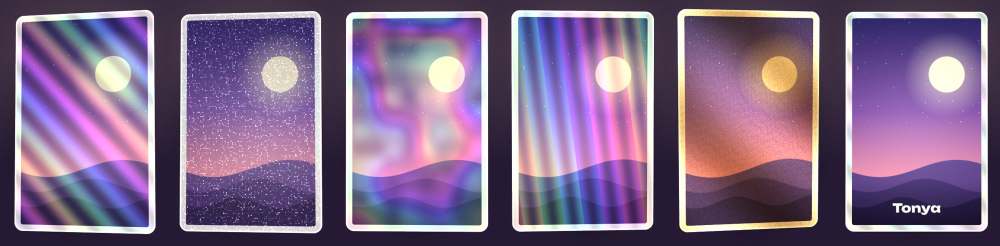

# Foil ✦

**English** | [繁體中文](README.zh-Hant.md) | [简体中文](README.zh-Hans.md)

**Turn your art into a holographic foil card that shimmers when you tilt it.**

Drop in a drawing, photo or photocard, pick a foil, and tilt: the rainbow light moves across the card like a real holo. Save it as a see-through PNG, or as a 4-second vertical video ready for Reels, Shorts and TikTok.

**▶ Try it: https://tllct122.github.io/foil-card/**

## Features

- ✦ **Five foils**: rainbow holo, glitter, galaxy, prism stripes and gold foil, rendered live as you tilt
- 🎯 **Choose where it shines**: everywhere, only the bright parts, only the dark parts (like a reverse holo), or just the border
- 📱 **Tilt with your phone**: the foil follows your phone's motion. On a computer, move your mouse over the card
- 🃏 **Card shapes**: K-pop photocard (55 × 85 mm), trading card (63 × 88 mm) or square, with your own corners, border colour and a name on the card
- 🎬 **Save a video**: a 4-second vertical clip of the card tilting, for Reels, Shorts and TikTok
- 🖼 **Save an image**: a high-resolution PNG with a transparent background
- 🌏 **English / 中文 / 廣東話**
- 🔒 **Private**: your pictures never leave your device. Works offline, no account, no ads

## Use it

| To | Do this |
|---|---|
| Add your picture | **Choose a picture**, or drag & drop / paste it |
| Change the foil | Pick one under **Foil**, then **Where it shines** |
| Make a reverse holo | **Where it shines → Dark parts** |
| Fit the picture | **Move & zoom the picture** |
| Post it | **Save a video** and upload it straight to Reels / Shorts / TikTok |
| Put it on your home screen | iPhone: Share → **Add to Home Screen**. Android: ⋮ → **Install app** |

## Support

If Foil made your cards shine, you can support it here:

- ☕ Buy Me a Coffee: https://buymeacoffee.com/sirene122

## License

[MIT](LICENSE)
