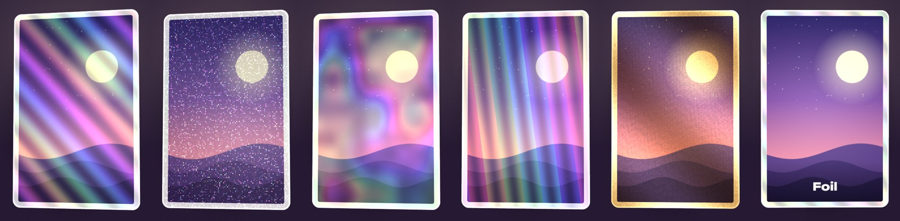
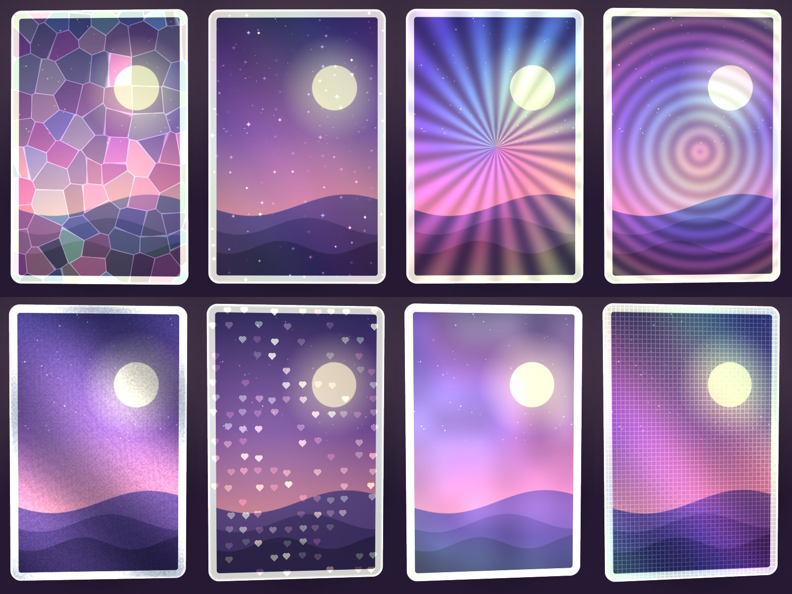

# Foil ✦

[English](README.md) | [繁體中文](README.zh-Hant.md) | **简体中文**

**把你的作品变成会随倾斜闪烁的镭射闪卡。**

放入你的画作、照片或小卡，选一种镭射效果，再倾斜一下：彩虹反光会像真正的闪卡一样在卡面流动。可以保存透明背景 PNG，或 4 秒竖屏视频，直接发 Reels、Shorts 和 TikTok。

**▶ 立即试用：https://tllct122.github.io/foil-card/**

## 功能

- ✦ **13 种镭射**：彩虹、闪粉、星空、棱镜、烫金、碎冰、星星、放射、水纹、烫银、爱心、珍珠、格纹，倾斜时实时变化
- 🎯 **选择反光位置**：全卡、只限亮部、只限暗部（类似 reverse holo），或只限边框
- 📱 **用手机倾斜**：镭射会跟着手机角度变化；在电脑上把鼠标移到卡片上即可
- 🃏 **卡片尺寸**：韩团小卡（55 × 85 mm）、游戏卡（63 × 88 mm）或正方形，可自定义圆角、边框颜色和卡上名字
- 🎬 **保存视频**：4 秒竖屏视频，适合 Reels、Shorts、TikTok
- 🖼 **保存图片**：高分辨率、透明背景 PNG
- 🌏 **English／中文／粤语**
- 🔒 **隐私**：图片不会离开你的设备。可离线使用、无需登录、没有广告

## 使用方法

| 想要 | 做法 |
|---|---|
| 加入图片 | **选择图片**，或拖放／粘贴 |
| 更改镭射 | 在 **镭射效果** 选一种，再选 **反光位置** |
| 做 reverse holo | **反光位置 → 暗部** |
| 调整图片 | **移动及缩放图片** |
| 发布 | **保存视频**，直接上传到 Reels／Shorts／TikTok |
| 添加到主屏幕 | iPhone：分享 → **添加到主屏幕**。Android：⋮ → **安装应用** |

## 支持

如果 Foil 让你的卡更闪，欢迎在这里支持：

- ☕ Buy Me a Coffee：https://buymeacoffee.com/sirene122

## 许可证

[MIT](LICENSE)
