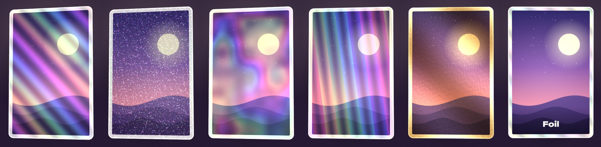
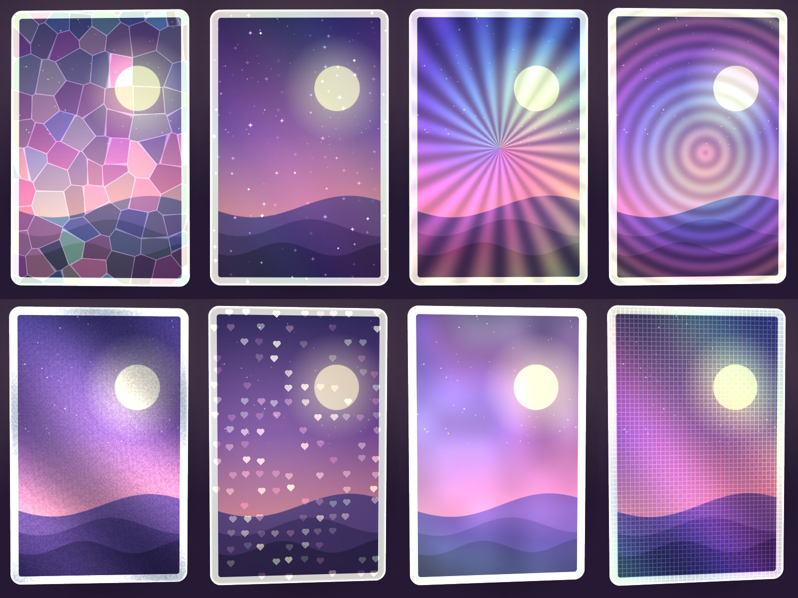

# Foil ✦

[English](README.md) | **繁體中文** | [简体中文](README.zh-Hans.md)

**把你的作品變成會隨傾斜閃爍的鐳射閃卡。**

放入你的畫作、相片或小卡，選一種鐳射效果，再傾斜一下：彩虹反光會像真正的閃卡一樣在卡面流動。可以儲存透明背景 PNG，或 4 秒直向影片，直接發 Reels、Shorts 和 TikTok。

**▶ 立即試用：https://tllct122.github.io/foil-card/**

## 功能

- ✦ **13 種鐳射**：彩虹、閃粉、星空、稜鏡、燙金、碎冰、星星、放射、水紋、燙銀、愛心、珍珠、格紋，傾斜時即時變化
- 🎯 **選擇反光位置**：全卡、只限亮位、只限暗位（類似 reverse holo），或只限邊框
- 📱 **用手機傾斜**：鐳射會跟著手機的角度變化；在電腦上把滑鼠移到卡片上即可
- 🃏 **卡片尺寸**：韓團小卡（55 × 85 mm）、遊戲卡（63 × 88 mm）或正方形，可自訂圓角、邊框顏色和卡上名字
- 🎬 **儲存影片**：4 秒直向影片，適合 Reels、Shorts、TikTok
- 🖼 **儲存圖片**：高解像度、透明背景 PNG
- 🌏 **English／中文／廣東話**
- 🔒 **私隱**：圖片不會離開你的裝置。可離線使用、不用登入、沒有廣告

## 使用方法

| 想要 | 做法 |
|---|---|
| 加入圖片 | **選擇圖片**，或拖放／貼上 |
| 更改鐳射 | 在 **鐳射效果** 選一種，再選 **反光位置** |
| 做 reverse holo | **反光位置 → 暗位** |
| 調整圖片 | **移動及縮放圖片** |
| 發佈 | **儲存影片**，直接上載到 Reels／Shorts／TikTok |
| 加到主畫面 | iPhone：分享 → **加入主畫面**。Android：⋮ → **安裝應用程式** |

## 支持

如果 Foil 令你的卡更閃，歡迎在這裡支持：

- ☕ Buy Me a Coffee：https://buymeacoffee.com/sirene122

## 授權

[MIT](LICENSE)
